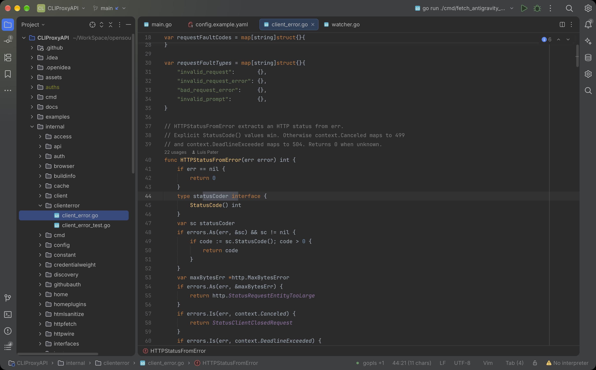
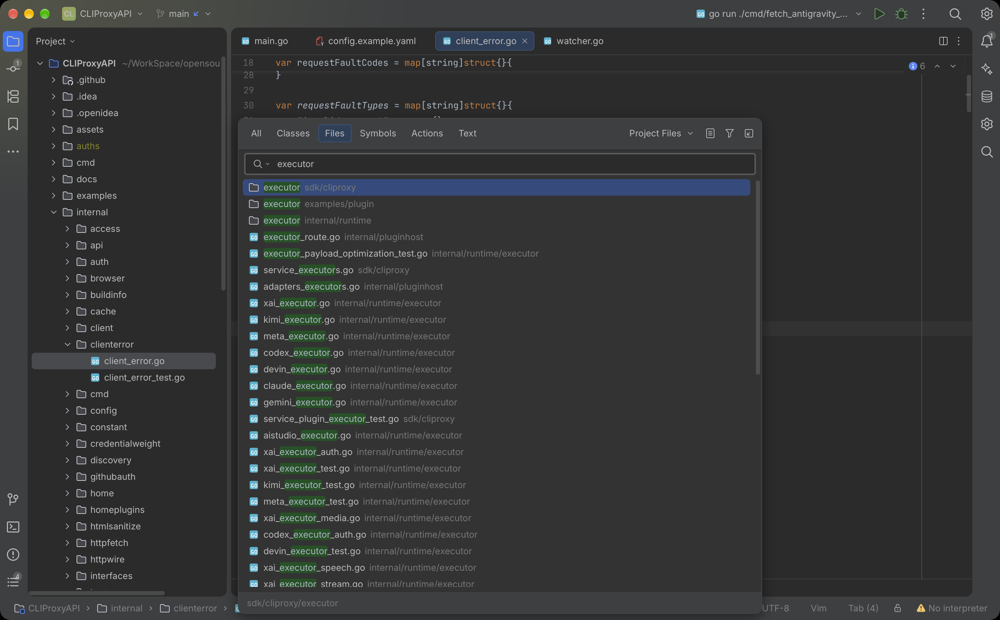

# Islands Darcula for OpenIDEA

[English](README.md) | [简体中文](README.zh-CN.md)


JetBrains **Islands Darcula** for OpenIDEA, with an optional **Darcula Contrast** variant. Compatible with OpenIDEA 0.1.40+ (Plugin API 1.2+).

## Themes

| Theme | Editor background | Syntax colors |
| --- | --- | --- |
| **Islands Darcula** | `#2B2B2B` | The existing Darcula scheme, unchanged |
| **Darcula Contrast** | `#1E1F22` | JetBrains Darcula Contrast, including purple PHP variables and fields (`#9876AA`) and gold PHP function and method calls (`#FFC66D`) |

Both themes share the Islands Darcula interface, including popups, search, diff, VCS, and terminal colors. OpenIDEA supplies layout, spacing, and rounded corners. The plugin contains configuration only and needs no executable module or permissions.

Darcula Contrast is generated from JetBrains' original `Darcula Contrast → Darcula` resources. It adds the darker editor background and updated current line, gutter, indent guides, warnings, and matched braces. The existing Islands Darcula theme keeps its original ID, files, and colors.

## Screenshots

These screenshots show **Islands Darcula** on macOS/OpenIDEA 0.1.43, using [CLIProxyAPI](https://github.com/router-for-me/CLIProxyAPI) ([MIT](licenses/CLIProxyAPI-MIT.txt)). They do not preview Darcula Contrast.





## Installation

1. Open **Settings → Plugins → Available** and search for **Islands Darcula**. If needed, use **⚙ → Rescan Plugins** to refresh the list.
2. Install the plugin.
3. In **Settings → Appearance → Theme**, choose **Islands Darcula** or **Darcula Contrast** and set the editor scheme to **Theme default**.

Darcula Contrast becomes available when a release containing this variant is installed. Older releases provide Islands Darcula only.

For a local checkout, use **Settings → Plugins → ⚙ → Install Plugin from Package File…** and select `plugin.toml`, or choose **Install Plugin from Disk…** and select the project folder. Published packages are available from the [original project's releases](https://github.com/longafterx/openidea-islands-darcula/releases/latest).

Before disabling or uninstalling the active theme, switch to the built-in **Islands Dark** theme to avoid the unavailable-theme message in OpenIDEA 0.1.40.

## Development

Both themes and their separate provenance records rebuild offline without dependencies:

```sh
python3 scripts/generate.py
python3 scripts/validate.py
```

Edit the generator, then rebuild. Validation checks both manifest entries, pinned hashes, reproducibility, supported tokens, aliases, source colors, and contrast thresholds.

## Sources and compatibility

See the original [color sources](docs/COLOR-SOURCES.md), the [Darcula Contrast source guide](docs/DARCULA-CONTRAST.md), and the separate token ledgers for [Islands Darcula](docs/TOKEN-MAPPING.md) and [Darcula Contrast](docs/DARCULA-CONTRAST-TOKEN-MAPPING.md).

Source RGB values are preserved where the editors expose equivalent roles. OpenIDEA has fewer syntax categories and font effects than PhpStorm; approximations and inherited values are documented. A side-by-side visual comparison with PhpStorm has not been performed for Darcula Contrast.

This community port is licensed under Apache-2.0. Original colors are from JetBrains, with a historical reference to Gerry's theme. See [third-party licenses](THIRD_PARTY_LICENSES.md) and [NOTICE](NOTICE).
