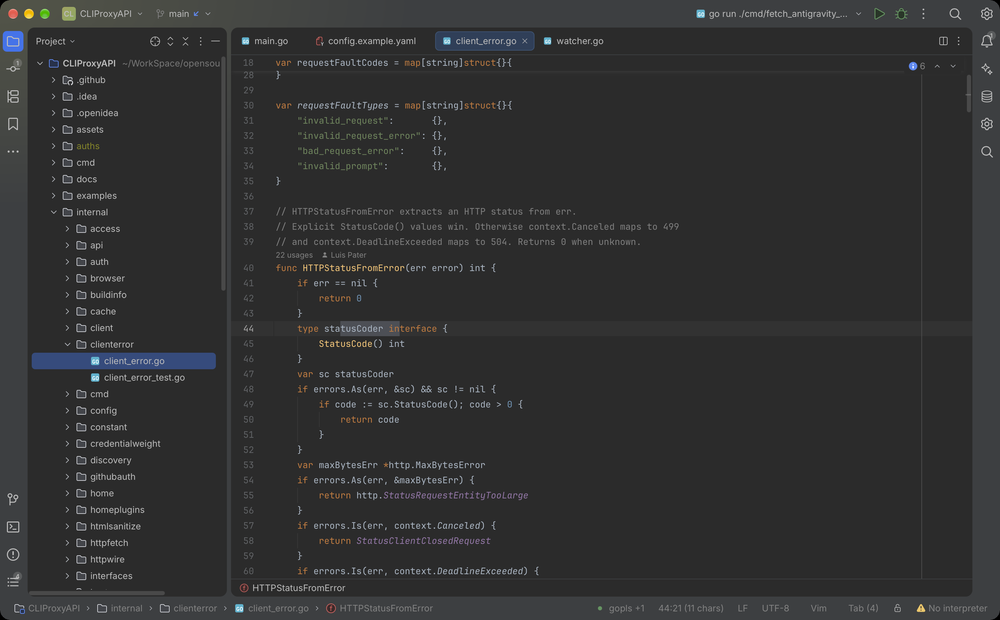
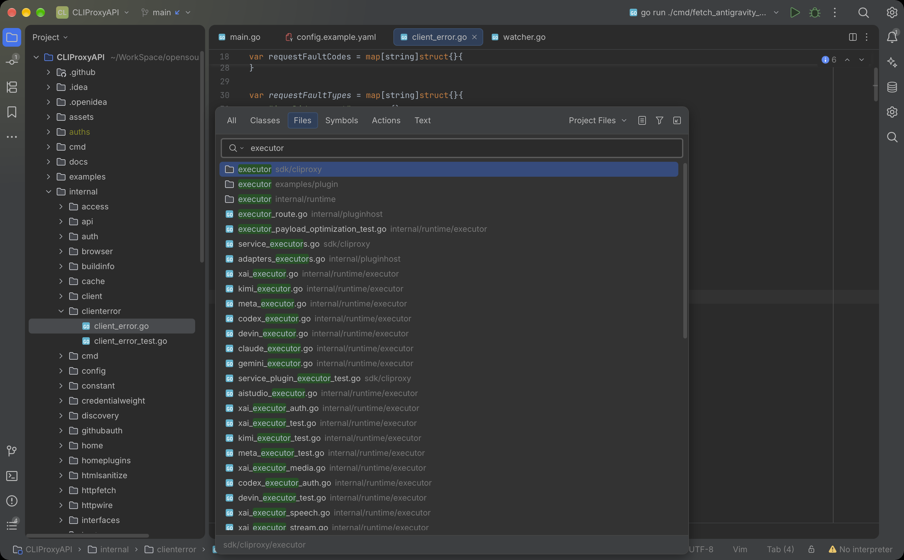

# Islands Darcula for OpenIDEA

将 IntelliJ IDEA 内置 **Islands Darcula** 的低对比度深色界面与 Darcula 编辑器配色带到 OpenIDEA。适用于 **OpenIDEA 0.1.40**（Plugin API 1.2+）。

## 主题特色

- 柔和的深灰界面，搭配 Darcula 橙色关键字、绿色字符串和紫色字段。
- 配套编辑器、弹窗、搜索、Diff、VCS 和终端 ANSI 配色。
- 保留 OpenIDEA 的 Islands 布局、间距与圆角；纯配置，无需 Rust/WASM 或额外权限。

## 效果截图

macOS / OpenIDEA 0.1.43 实机截图，示例项目为 [CLIProxyAPI](https://github.com/router-for-me/CLIProxyAPI)（[MIT](licenses/CLIProxyAPI-MIT.txt)）。

**主题效果图**

## 安装

1. 打开 OpenIDEA 的 **Settings → Plugins → Available**。
2. 搜索 **Islands Darcula** 并安装；若未找到，点击 **⚙ → Rescan Plugins** 刷新列表。
3. 在 **Settings → Appearance → Theme** 选择 **Islands Darcula**，编辑器配色使用 **Theme default**。

也可从 [Releases](https://github.com/longafterx/openidea-islands-darcula/releases/latest) 下载 `.oiplugin`，通过 **Settings → Plugins → ⚙ → Install Plugin from Package File…** 手动安装。

## 必要说明

- 部分语法分类与控件颜色为近似移植，不承诺像素级一致。已在 macOS 验证，Windows/Linux 尚未实测。
- **禁用或卸载前，先切回内置 Islands Dark**，以规避 OpenIDEA 0.1.40 禁用当前主题时可能出现的“主题不可用”提示。
- Apache-2.0；原配色来自 JetBrains，另参考 Gerry 的主题。详见[颜色来源](docs/COLOR-SOURCES.md)、[第三方许可](THIRD_PARTY_LICENSES.md)和 [NOTICE](NOTICE)。本项目为社区移植。
